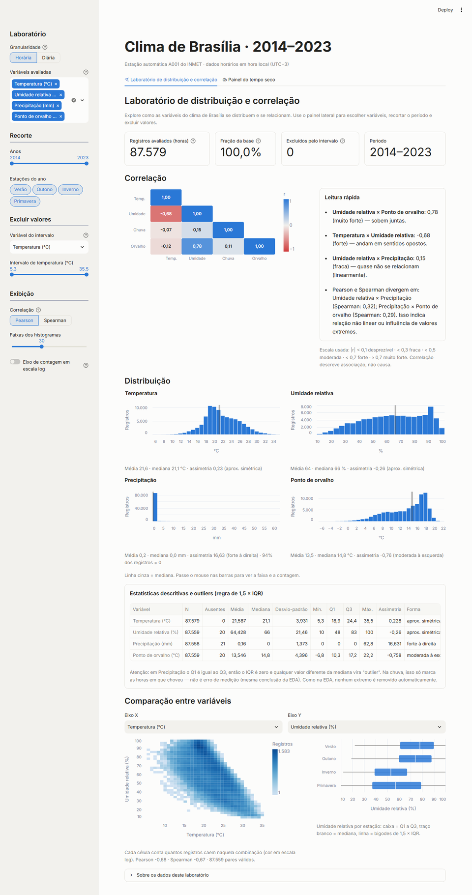
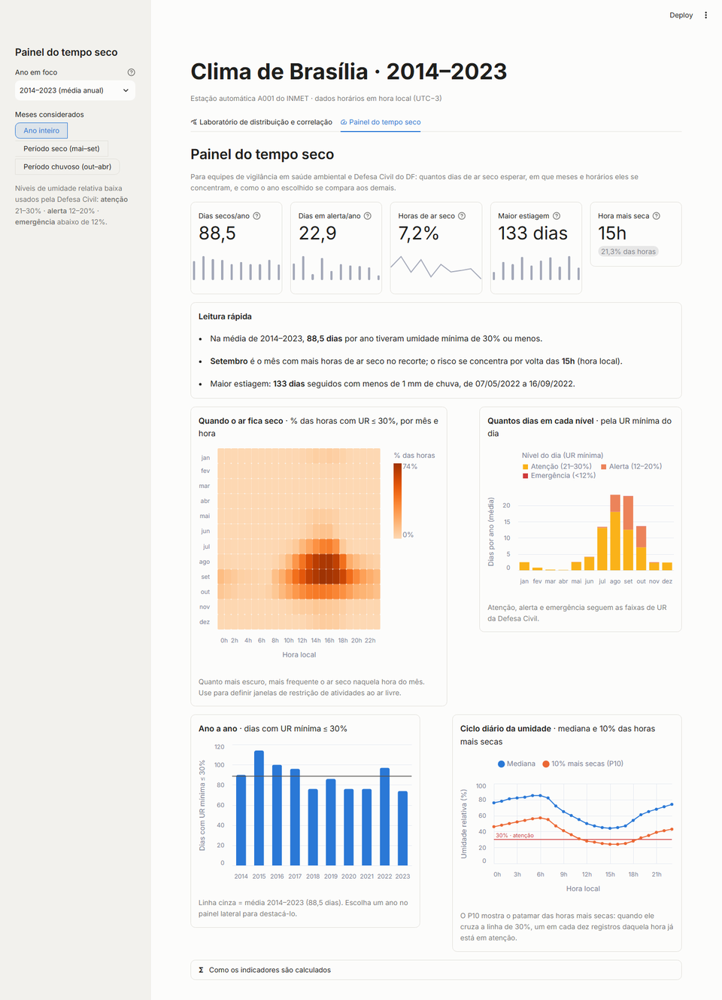

# Clima de Brasília — dashboards em Streamlit

## 🔗 [Abrir o app publicado → clima-brasilia-avd.streamlit.app](https://clima-brasilia-avd.streamlit.app)

Dois dashboards em Streamlit construídos a partir da minha análise exploratória (EDA) dos dados horários da estação
automática do INMET em Brasília (A001), de 2014 a 2023. O primeiro é um laboratório para explorar distribuições e
correlações; o segundo resume o **tempo seco** em indicadores para quem planeja alertas e ações de saúde.

Atividade prática das Aulas 21, 22 e 23 da disciplina **Análise e Visualização de Dados** (CESAR School, 2026.2) —
João Victor Uchôa.

| Dashboard 1 — Laboratório de distribuição e correlação | Dashboard 2 — Painel do tempo seco |
| --- | --- |
|  |  |

**Como navegar:** os dois dashboards ficam em abas no topo da página. A barra lateral muda conforme a aba aberta e
mostra só os filtros daquele dashboard. No celular, a barra lateral abre pelo botão `»` no canto superior esquerdo.

## Objetivo da atividade

Transformar a EDA da Aula 11 em um app com duas abas: (1) correlação + distribuição das variáveis quantitativas,
com filtros na barra lateral, e (2) KPIs para um público-alvo definido, e publicar o app no Streamlit Community
Cloud.

## Dataset

- **Fonte:** INMET — estação automática A001 (Brasília), arquivos anuais do
  [portal de dados históricos](https://portal.inmet.gov.br/dadoshistoricos). É o mesmo recorte usado em aula
  (`clima_brasilia.csv`).
- **Período:** 01/01/2014 a 31/12/2023, uma linha por hora (87.579 horas no dado tratado).
- **Variáveis medidas:** temperatura do ar (°C), umidade relativa (%) e precipitação (mm/h).
- **Tratamento (EDA da Aula 11):** o código `-9999` (sem leitura) virou ausente (20 horas de umidade e 21 de
  chuva); nenhum outlier foi removido, porque extremos de clima podem ser reais.
- **Acréscimos para o app** ([eda-com-downloads.ipynb](notebooks/eda-com-downloads.ipynb)): hora convertida de UTC
  para hora local (UTC−3) — por isso as 3 primeiras horas de 2014 em UTC, que caem em 2013, saíram —, estação do
  ano, período seco (mai–set) / chuvoso (out–abr) e ponto de orvalho (fórmula de Magnus).
- **Lacunas:** 66 horas sem temperatura no arquivo original (o dia 03/01/2018 inteiro, por exemplo) ficam de fora;
  nos indicadores diários, um dia só conta se tiver pelo menos 20 horas medidas.
- **Dado sensível:** nenhum. São medições meteorológicas públicas de uma estação oficial.

Principais achados da EDA que guiaram os dashboards: temperatura e umidade têm correlação de −0,68; a chuva é quase
toda zero (94% das horas) e muito concentrada no período chuvoso; a umidade cai muito no inverno e na primavera e
ao longo da tarde.

## Dashboard 1 — Laboratório de distribuição e correlação

Para quem explora o dado. Tudo responde aos filtros da barra lateral.

- **Filtros:** granularidade (horária ou diária — máxima, mínima, amplitude, umidade mínima, chuva do dia...),
  **seletor de variáveis**, anos, estações, **slider de intervalo** de qualquer variável (exclui os registros fora
  dele), Pearson ou Spearman, nº de faixas e escala log dos histogramas.
- **Heatmap de correlação** (triângulo inferior) com uma leitura automática dos pares mais fortes e um aviso quando
  Pearson e Spearman divergem.
- **Histograma de cada variável** com mediana, média e classificação da assimetria.
- **Tabela de estatísticas** com outliers pela regra de 1,5 × IQR (com o aviso de que, na chuva, o IQR é zero e
  "outlier" só significa "choveu", como na EDA).
- **Comparação entre duas variáveis:** mapa de densidade X × Y e boxplot por estação.

## Dashboard 2 — Painel do tempo seco

**Público-alvo:** equipes de **vigilância em saúde ambiental e Defesa Civil do Distrito Federal**, que planejam
alertas de umidade baixa, campanhas e orientações (por exemplo, suspender atividade física ao ar livre nas horas
mais secas). A escolha e cada métrica estão justificadas em
[entregas/justificativa-metricas.md](entregas/justificativa-metricas.md).

Filtros: **ano em foco** (comparado com a média 2014–2023) e **meses considerados** (ano inteiro, período seco ou
chuvoso). Faixas de umidade da Defesa Civil: atenção 21–30%, alerta 12–20%, emergência abaixo de 12%.

| KPI | Fórmula | Unidade | 2014–2023 |
|---|---|---|---|
| Dias secos | dias com umidade mínima ≤ 30% ÷ nº de anos | dias/ano | 88,5 |
| Dias em alerta | dias com umidade mínima ≤ 20% ÷ nº de anos | dias/ano | 22,9 |
| Horas de ar seco | horas com umidade ≤ 30% ÷ horas medidas | % | 7,2% |
| Maior estiagem | maior sequência de dias seguidos com chuva < 1 mm | dias | 133 (mai–set/2022) |
| Hora mais seca | hora local com a maior fração de horas com umidade ≤ 30% | hora | 15h |

Visualizações: mapa **mês × hora** da fração de horas com ar seco, **dias por nível** de umidade em cada mês,
**série anual** com o ano em foco destacado e **ciclo diário** da umidade (mediana e 10% das horas mais secas).
Um expansor mostra as fórmulas, a tabela de indicadores por ano e um botão para baixá-la em CSV.

## Estrutura

```
app.py                        # ponto de entrada: abas dos dois dashboards
src/
  data_loader.py              # leitura do CSV tratado e agregação diária (com cache)
  variaveis.py                # nomes, unidades e descrição das variáveis
  estatisticas.py             # descritivas, outliers, correlação e agregações (sem Streamlit)
  indicadores.py              # fórmulas dos KPIs do Dashboard 2 (sem Streamlit)
  dashboard1.py, dashboard2.py
  formatacao.py               # números em pt-BR e paleta de cores
data/clean/dataset.csv        # dataset tratado (é o que o app lê)
notebooks/
  eda.ipynb                   # EDA original da Aula 11, sem alterações
  eda-com-downloads.ipynb     # tratamento + conferência com a EDA + exportação para data/clean
  arquivo-eda-original.ipynb  # EDA de referência do professor
data/raw/                     # dado bruto (não versionado; ver "Como rodar localmente")
entregas/                     # rascunhos dos dois dashboards + justificativa das métricas
prompts/                      # uso de IA: template, prompts utilizados e declaração
tests/                        # testes dos dados, dos cálculos e do app
docs/img/                     # capturas de tela usadas neste README
.streamlit/config.toml        # identidade visual (tema claro e escuro)
```

## Como rodar localmente

Requer **Python 3.11 a 3.15**.

```bash
# criar e ativar o ambiente
python -m venv .venv               # Windows: py -m venv .venv
source .venv/bin/activate          # Windows (PowerShell): .venv\Scripts\Activate.ps1

python -m pip install -r requirements.txt
streamlit run app.py               # abre em http://localhost:8501
```

Rodar os testes (60 testes: dados, cálculos e widgets do app):

```bash
python -m pytest
```

Para regerar `data/clean/dataset.csv`, coloque o `clima_brasilia.csv` da EDA em `data/raw/` (ou deixe o notebook
baixar os arquivos do INMET) e execute `notebooks/eda-com-downloads.ipynb`. A pasta `data/raw/` não é versionada.

## Dependências

`streamlit` (≥ 1.66), `pandas`, `numpy`, `scipy` (usado pelo pandas na correlação de Spearman), `altair` (vem com o
Streamlit); para os notebooks, `matplotlib`, `ipykernel` e `requests`; para os testes, `pytest`. Versões em
[requirements.txt](requirements.txt).

## Entregáveis

| Item | Onde |
|---|---|
| App publicado | [clima-brasilia-avd.streamlit.app](https://clima-brasilia-avd.streamlit.app) |
| Aplicação Streamlit | [app.py](app.py) + [src/](src) |
| EDA original (Aula 11) | [notebooks/eda.ipynb](notebooks/eda.ipynb) |
| Tratamento e exportação do dado | [notebooks/eda-com-downloads.ipynb](notebooks/eda-com-downloads.ipynb) |
| Rascunho do Dashboard 1 | [entregas/rascunho-dashboard1.png](entregas/rascunho-dashboard1.png) |
| Rascunho do Dashboard 2 | [entregas/rascunho-dashboard2.png](entregas/rascunho-dashboard2.png) |
| Descrição dos rascunhos | [entregas/rascunhos.md](entregas/rascunhos.md) |
| Justificativa das métricas | [entregas/justificativa-metricas.md](entregas/justificativa-metricas.md) |
| Prompts utilizados | [prompts/prompts-utilizados.md](prompts/prompts-utilizados.md) |
| Declaração de uso de IA | [prompts/declaracao-uso-ia.md](prompts/declaracao-uso-ia.md) |
| Dependências | [requirements.txt](requirements.txt) |

## Publicação

O app roda no **Streamlit Community Cloud** a partir deste repositório: branch `main`, arquivo principal `app.py`,
Python 3.13. Cada `git push` na `main` atualiza o app automaticamente. O link é público e não pede login; não há
segredos nem variáveis de ambiente. Se o app ficar um tempo sem acessos, ele entra em espera e acorda com um clique
no botão exibido na página.

## Validação

- **Testes automatizados** (`python -m pytest`, 60 testes): o dataset tratado bate com a EDA (linhas, ausentes,
  médias, correlação), sem duplicadas e sem dados pessoais; correlação igual à do pandas; outliers por IQR;
  fórmulas dos KPIs conferidas com cálculo direto; e os widgets do app simulados com 0, 1 e várias variáveis,
  intervalo de um único valor, nenhuma estação, granularidade diária, os 10 anos em foco e os recortes de meses.
  Também passam num ambiente virtual novo, instalado só com o `requirements.txt`.
- **App publicado** (03/11/2026, navegador anônimo): abre sem login, as duas abas carregam, todos os filtros
  respondem (seletor de variáveis, slider de intervalo, granularidade, Spearman, estações, ano em foco, recorte de
  meses, download), sem erros no console e sem rolagem horizontal no celular.

## Limitações

- Uma única estação (A001, Plano Piloto): outras regiões do DF podem ter clima diferente.
- Dez anos de dados: a média 2014–2023 é uma referência descritiva, não uma normal climatológica de 30 anos.
- Os dashboards descrevem o que foi medido; não fazem previsão nem indicam causa.

## Uso de IA

O desenvolvimento teve apoio do Claude Code (Claude Opus 5.5). Os arquivos de código feitos com IA estão marcados
com `# [IA]` no topo. Os prompts estão em [prompts/prompts-utilizados.md](prompts/prompts-utilizados.md) e a
declaração em [prompts/declaracao-uso-ia.md](prompts/declaracao-uso-ia.md).

---

Passo a passo das aulas: [ROTEIRO.md](ROTEIRO.md) · Guia de seleção cruzada no Altair:
[ALTAIR-CROSSFILTER.md](ALTAIR-CROSSFILTER.md).
