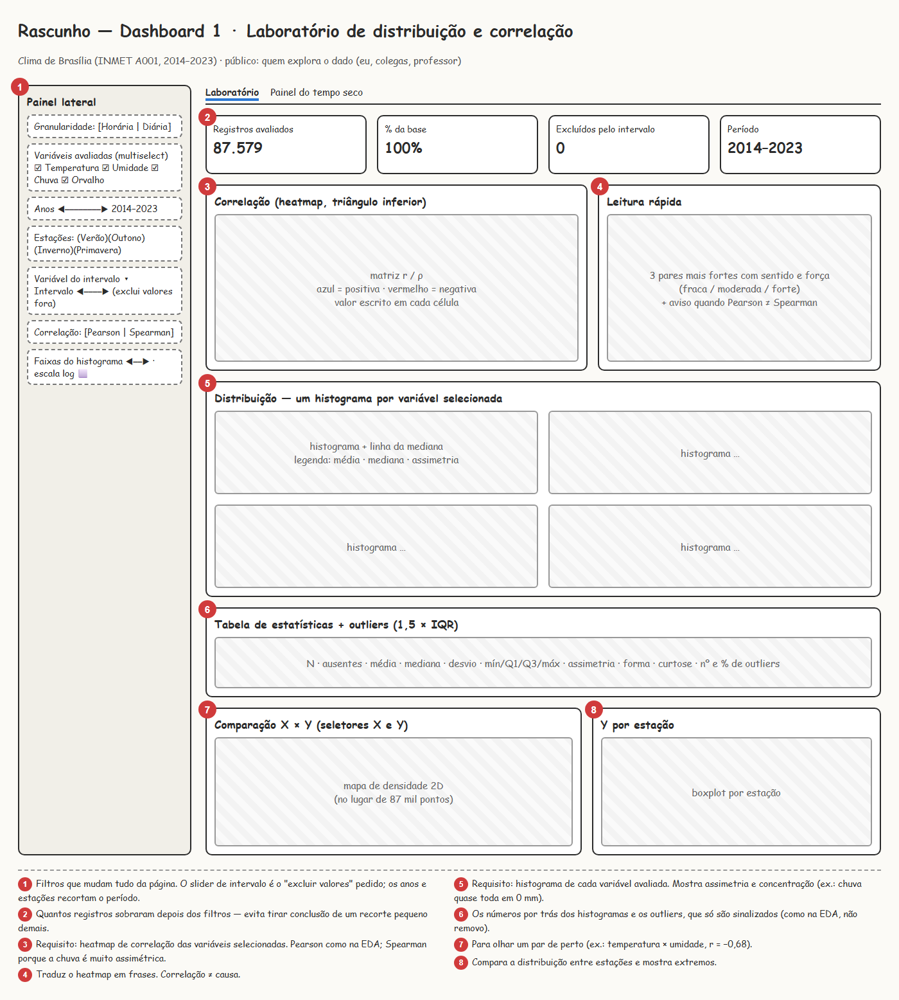
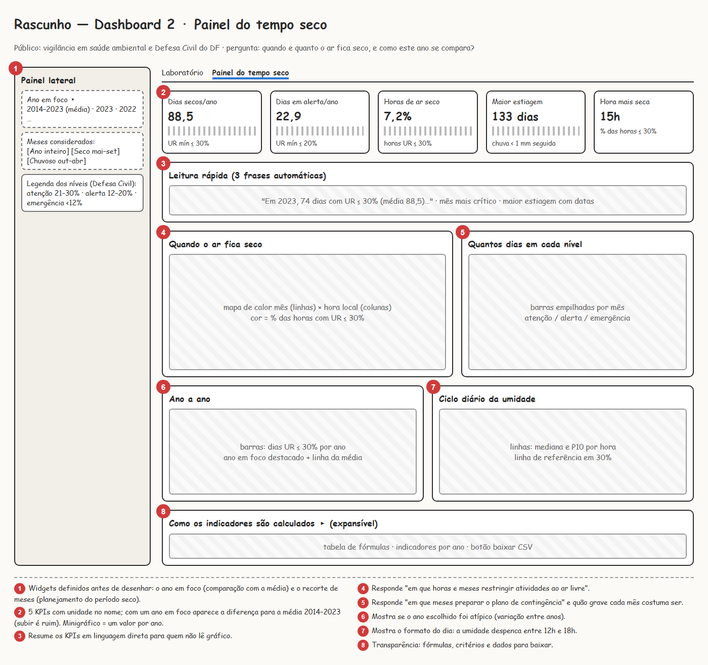

# Rascunhos dos dashboards

Os rascunhos foram feitos antes da implementação, a partir da EDA e das perguntas de cada público.
As imagens numeradas estão nesta pasta; abaixo, o que cada elemento é e por que está lá.

## Dashboard 1 — Laboratório de distribuição e correlação

**Para quem:** quem explora o dado (eu, colegas, professor). **Pergunta:** como as variáveis do clima de Brasília
se distribuem e se relacionam, e isso muda quando eu recorto o período ou excluo valores?

| # | Elemento | Tipo | Finalidade |
|---|---|---|---|
| 1 | Painel lateral | widgets | Granularidade (horária/diária), **seletor de variáveis** (multiselect), anos, estações, **slider de intervalo** de uma variável escolhida (exclui os registros fora do intervalo), método da correlação, nº de faixas e escala log dos histogramas. Todo o resto da página recalcula a partir daqui. |
| 2 | Faixa de contexto | `st.metric` | Registros avaliados, % da base, excluídos pelo intervalo e período. Evita conclusões sobre um recorte pequeno demais. |
| 3 | **Heatmap de correlação** | Altair `mark_rect` | Triângulo inferior com o valor em cada célula; escala divergente azul (positiva) ↔ vermelho (negativa) com o zero neutro. Pearson por padrão (como na EDA) e Spearman como opção, porque a chuva é muito assimétrica. |
| 4 | Leitura rápida | texto gerado | Os 3 pares mais fortes com sentido e força (fraca/moderada/forte) e aviso quando Pearson e Spearman divergem (sinal de relação não linear ou de extremos). |
| 5 | **Histogramas** | Altair `mark_bar` | Um por variável selecionada, com a linha da mediana e, na legenda, média, mediana e classificação da assimetria. |
| 6 | Estatísticas e outliers | `st.dataframe` | N, ausentes, média, mediana, desvio, quartis, assimetria, curtose e outliers pela regra de 1,5 × IQR. Outliers só são sinalizados (como na EDA). |
| 7 | Comparação X × Y | Altair `mark_rect` (2D) | Densidade de pares escolhidos pelo usuário; substitui um gráfico de dispersão com 87 mil pontos. |
| 8 | Boxplot por estação | Altair | Compara a distribuição da variável do eixo Y entre as estações e mostra os extremos. |

**Casos de borda planejados:** 0 variáveis (aviso), 1 variável (histograma e tabela, sem heatmap), nenhuma
estação ou filtro vazio (aviso), variável constante no recorte (correlação "—" com explicação).

## Dashboard 2 — Painel do tempo seco

**Para quem:** equipes de vigilância em saúde ambiental e Defesa Civil do DF. **Pergunta:** quantos dias de ar seco
esperar, em que meses e horários eles se concentram, e como o ano escolhido se compara à média?
A justificativa de cada KPI está em [justificativa-metricas.md](justificativa-metricas.md).

| # | Elemento | Tipo | Finalidade |
|---|---|---|---|
| 1 | Painel lateral | widgets | *Ano em foco* (um ano ou a média 2014–2023) e *Meses considerados* (ano inteiro, período seco, período chuvoso), com a legenda das faixas de umidade. |
| 2 | **5 KPIs** | `st.metric` com minigráfico | Dias secos/ano (UR mínima ≤ 30%), dias em alerta/ano (≤ 20%), horas de ar seco (% das horas ≤ 30%), maior estiagem (dias seguidos com chuva < 1 mm) e hora mais seca. Com um ano em foco, mostram a diferença para a média (subir = pior). |
| 3 | Leitura rápida | texto gerado | Três frases com os números principais para quem não lê gráfico. |
| 4 | Mapa mês × hora | Altair heatmap | % das horas com UR ≤ 30% em cada mês e hora local: quando restringir atividades ao ar livre. |
| 5 | Dias por nível em cada mês | Altair barras empilhadas | Atenção / alerta / emergência por mês (média por ano ou contagem do ano em foco): quando preparar o plano de contingência. |
| 6 | Ano a ano | Altair barras | Dias secos por ano com o ano em foco destacado e a média como linha de referência: o ano foi atípico? |
| 7 | Ciclo diário | Altair linhas | Mediana e percentil 10 da umidade por hora, com a linha de 30%: como é o dia típico e o dia mais seco. |
| 8 | Metodologia | expander | Fórmulas, critérios, indicadores por ano e download em CSV. |

## Do rascunho para o app

O app publicado segue os dois rascunhos. Ajustes feitos durante a implementação:

- os rótulos dos KPIs ficaram mais curtos para não truncar em telas menores (a unidade foi para o nome do KPI);
- o heatmap do Dashboard 1 usa nomes curtos nos eixos e o nome completo no tooltip;
- na seção de comparação do Dashboard 1, os seletores X e Y ficaram acima do gráfico, e não no painel lateral,
  porque só afetam esse par de gráficos.
